# EDEN: signal in the static, fragments of a lost archive, rebuilding EDEN

Team **llcd**, Olympus Tech 4.0 Data Science problem statement. This repository solves all three stages. Every figure and number in the
reports below is produced by the notebooks, so the work can be reproduced from the provided dataset.

## At a glance
- **Part One.** A faint moving source is detected in all 20 frames, at about 5 sigma per raw frame and about 10 sigma after smoothing
  (difference-image noise 2.9 ADU; only 0.23 false pixels expected by chance). It travels about 28 px along a smooth, slightly curved path,
  speeding up from 1.35 to 1.64 px/frame; a quadratic fits far better than a straight line (F-test p = 6.5e-16).
- **Part Two.** Cleaning merged spelling and ordering variants (for example `star_type` 51 to 18 labels, `planet_type` 44 to 11), sent rare
  one-off labels to `other`, and filled missing gas percentages from the atmosphere string, which agrees with the numeric columns on
  98-99.9% of rows. Primary hazard explains about 10% of the variance of the settlement index; oxygen is strongly and positively related to it
  (Spearman rho = 0.57); single-star systems score above binary and triple ones; rings cost about 2.7 points; rogue and tidally locked planets
  score about 3 points below the rest. In the independent investigation, temperature and pressure both show Goldilocks optima
  (about 12.5 C and about 1 atm), and together the best region (13.5-28 C, 0.84-1.02 atm) averages 79 against 59 overall.
- **Bonus.** A gradient-boosting model predicts viability (settlement index >= 60); its hold-out metrics, errors and most important
  properties are in the Bonus section below.

## Repository layout
```
README.md                         this report (built by build_report.py)
build_report.py, requirements.txt
dataset/                          the provided data (unchanged)
llcd_notebook_FITS.ipynb        Part One analysis
llcd_FITS_outputs/              raw_frames/, difference_images/, median_reference.png
llcd_trajectory.png             Part One trajectory plot
llcd_task1_solution.md          Part One report
llcd_notebook_cleaning.ipynb    Part Two cleaning
llcd_cleaned_dataset.csv        cleaned training data
llcd_cleaned_test.csv           test data cleaned with the same (training-fitted) rules
llcd_notebook_analysis.ipynb    Part Two analysis and independent investigation
llcd_task2_plots/, llcd_task2_solution.md
llcd_notebook_ML.ipynb          Bonus model
llcd_predicted.csv              Bonus predictions (same format as sample_submission.csv)
llcd_ml_results.png, llcd_bonus_discussion.md
```

## How to reproduce
1. Put the provided `dataset/` folder next to the notebooks and run `pip install -r requirements.txt`.
2. Run the notebooks in this order: `llcd_notebook_FITS`, `llcd_notebook_cleaning`, `llcd_notebook_analysis`, `llcd_notebook_ML`.
3. Run `python build_report.py` to regenerate this README from the latest reports.

---

## Task 1: Signal in the Static (team llcd)

All figures and numbers below are produced by `llcd_notebook_FITS.ipynb`.

### 1. Raw frames
There are 20 FITS frames of 200 x 200 pixels (field "EDEN Deep Field 07", 60.0 s exposures, signal in ADU), ordered by the `FRAME` header keyword. `DATE-OBS` gives 90-90 s between consecutive frames. The headers contain no world-coordinate information, so there is no pixel scale: positions and speeds are in pixels. Every frame is plotted with labelled axes and a colorbar in `llcd_FITS_outputs/raw_frames/`, all with one shared contrast stretch (1st-99.5th percentile) so they can be compared directly.

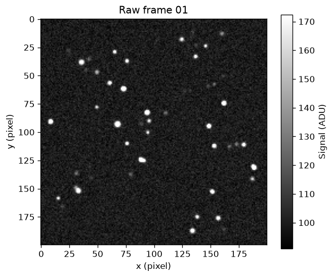

### 2. Median reference and difference images
The reference image is the per-pixel median of all 20 frames (`llcd_FITS_outputs/median_reference.png`). Stars and background sit on the same pixels in every frame, so they pass through the median unchanged, while the moving source occupies any one pixel in only a few frames, so the median rejects it. Subtracting the reference from each frame (and removing the small per-frame background offset) cancels everything static and leaves only what changed in that frame: the moving source as a faint positive blob, plus noise and small residuals around the brightest stars. The difference images are in `llcd_FITS_outputs/difference_images/`, with the tracked source circled in red.


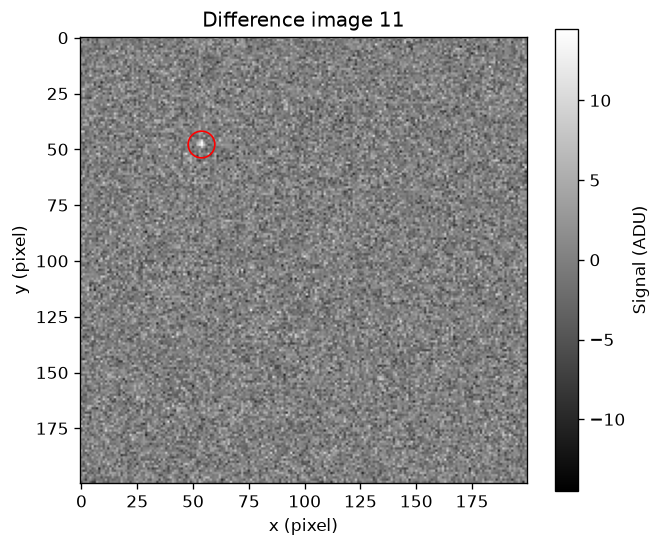

### 3. Detecting the moving source
The noise of each difference image is its sigma-clipped standard deviation (mean 2.90 ADU). Each difference image is smoothed with a 1-pixel Gaussian, which suits a point source and lowers the noise to 0.83 ADU, and every group of at least 2 connected pixels above 5 sigma is a candidate. This gives 23 candidates. They are separated as follows:
- **0 static residuals** (imperfectly subtracted stars): a detection that recurs within 2 px of the same spot in more than half of the frames cannot be a moving object.
- **3 other candidates** (isolated noise peaks): they do not line up with each other or with the track.
- **20 detections that form one track**: the constant-velocity line matched (within 2 px) by detections in the most frames, whose detections spread over at least 6 px (a stationary residual cannot do that). The source is detected in 20 of 20 frames, one detection per frame.

### 4. Trajectory
Measured centroids and the fitted path (`llcd_trajectory.png`):

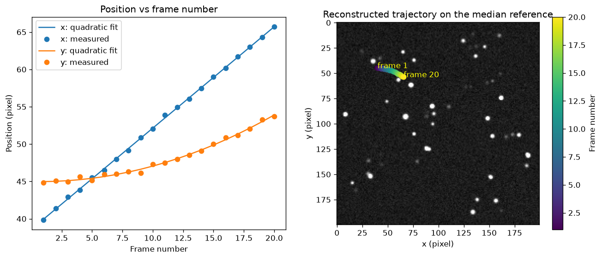

| frame | x_measured | y_measured | x_model | y_model |
|---|---|---|---|---|
| 1 | 39.85 | 44.81 | 39.95 | 44.97 |
| 2 | 41.36 | 45.08 | 41.3 | 45.01 |
| 3 | 42.92 | 44.99 | 42.65 | 45.1 |
| 4 | 43.85 | 45.65 | 44.01 | 45.24 |
| 5 | 45.53 | 45.13 | 45.36 | 45.42 |
| 6 | 46.52 | 45.94 | 46.72 | 45.65 |
| 7 | 48.0 | 45.98 | 48.07 | 45.93 |
| 8 | 49.17 | 46.31 | 49.43 | 46.26 |
| 9 | 50.9 | 46.14 | 50.78 | 46.63 |
| 10 | 52.02 | 47.29 | 52.14 | 47.05 |
| 11 | 53.9 | 47.5 | 53.49 | 47.52 |
| 12 | 54.93 | 47.96 | 54.85 | 48.04 |
| 13 | 56.07 | 48.51 | 56.21 | 48.6 |
| 14 | 57.48 | 49.08 | 57.56 | 49.22 |
| 15 | 59.02 | 49.99 | 58.92 | 49.88 |
| 16 | 60.17 | 50.87 | 60.28 | 50.58 |
| 17 | 61.7 | 51.21 | 61.63 | 51.34 |
| 18 | 63.0 | 52.03 | 62.99 | 52.14 |
| 19 | 64.3 | 53.29 | 64.35 | 53.0 |
| 20 | 65.72 | 53.71 | 65.71 | 53.9 |

The source follows a smooth, slightly curved path: a quadratic fits the measured centroids significantly better than a straight line (F-test p = 6.5e-16; RMS residual 0.27 px vs 0.76 px), so the apparent velocity changes slowly from 1.35 to 1.64 px/frame. Over the 20 frames it travels 28 px (overall direction 19 degrees from the +x axis, y pointing down), i.e. about 0.97 px per minute at the 90 s frame spacing.

**What kind of object?** Stars and nebulosity do not move and noise does not move coherently, so a source that shifts smoothly in one direction over 20 frames is a real object whose position relative to the background stars changes. That is the signature of a foreground body: in a real survey a solar-system minor body (asteroid or comet), another nearby object, or an artificial one such as a spacecraft. A slowly changing apparent velocity is what a body on a gravity-curved orbit shows, or any body seen from a moving observer. Distance, size and physical speed cannot be obtained because the headers have no pixel scale.

### 5. Noise, signal strength, reliability and limitations
- **Noise:** 2.90 ADU per pixel in the difference images (frame-to-frame range 2.87-2.93 ADU); 0.83 ADU after smoothing.
- **Signal:** the source peaks at 14.9 ADU (median over detected frames), which is 5.1 sigma in the raw difference images (weakest frame 3.4 sigma) and 9.9 sigma in the smoothed ones.
- **Reliability:** with Gaussian noise only 0.23 pixels over all frames would exceed 5 sigma by chance. The source is found in 20 of 20 frames and the centroids follow one smooth path to 0.27 px RMS, so a chance alignment of noise peaks is extremely unlikely.
- **Limitations:** (1) In single raw frames the source is only about 5 sigma, so the detection relies on smoothing and on consistency across frames, not on any one frame. (2) The noise is not perfectly Gaussian: near bright stars the subtraction leaves larger residuals, so the global sigma understates the local noise there. (3) The path model is a low-order polynomial; the measured centroids scatter by 0.27 px RMS around it. (4) A source that stays within 2 px for more than half of the frames would be absorbed into the median and removed as static. (5) Only the single best track is searched for; a second, fainter mover would need another pass. (6) Without a pixel scale, no physical size, distance or speed can be derived.

---

## Task 2: Data analysis (team llcd)

All numbers and figures come from `llcd_notebook_analysis.ipynb`, which analyses `llcd_cleaned_dataset.csv` (6400 planets; settlement_index mean 59.2, sd 10.8). Group differences use Kruskal-Wallis and Bonferroni-corrected Mann-Whitney tests, trends use Spearman's rho; all are rank-based because the data are skewed. The data are observational, so every result is an association, not proof of cause, and planets that differ in one property also differ in others.

### Q1. How does the recorded primary hazard relate to settlement potential?
The mean settlement_index is highest for **none** (83.9, n = 9) and lowest for **extreme_temperature** (54.5, n = 20). The difference between the hazard groups is significant (p = 9.7e-101) and the grouping explains 9.9% of the variance of settlement_index.

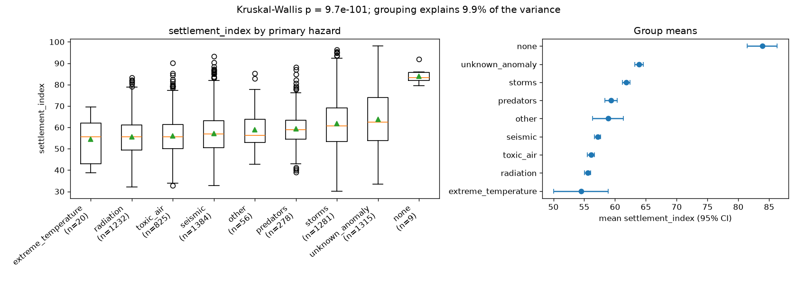

| primary_hazard | n | mean | median | sd | ci95 |
|---|---|---|---|---|---|
| extreme_temperature | 20 | 54.46 | 55.57 | 10.13 | 4.44 |
| radiation | 1232 | 55.54 | 55.57 | 8.48 | 0.47 |
| toxic_air | 825 | 56.1 | 55.69 | 8.45 | 0.58 |
| seismic | 1384 | 57.16 | 56.9 | 9.53 | 0.5 |
| other | 56 | 58.85 | 56.24 | 9.58 | 2.51 |
| predators | 278 | 59.35 | 58.84 | 8.45 | 0.99 |
| storms | 1281 | 61.84 | 60.7 | 11.11 | 0.61 |
| unknown_anomaly | 1315 | 63.87 | 62.5 | 12.7 | 0.69 |
| none | 9 | 83.9 | 83.35 | 3.71 | 2.42 |

### Q2. How do atmospheric gas levels relate to settlement potential?
Only planets whose value was recorded (not filled in during cleaning) are used for each gas.

- **oxygen_percent**: Spearman rho = 0.57, a strong positive association, significant (p < 1e-300); the decile means are highest around 18 % (69.6) and lowest around 0 % (52.2).
- **co2_percent**: Spearman rho = -0.18, a weak negative association, significant (p = 1.6e-40); the decile means are highest around 1 % (69.3) and lowest around 0 % (52.6).
- **methane_percent**: Spearman rho = -0.12, a weak negative association, significant (p = 9e-18); the decile means are highest around 0.0002 % (68.5) and lowest around 65 % (53.2).

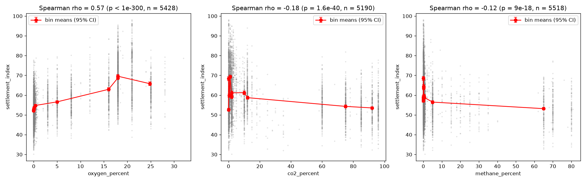

### Q3. How does stellar multiplicity relate to settlement potential?
The mean settlement_index is highest for **single** (60.1, n = 4008) and lowest for **star + brown dwarf** (55.7, n = 242). The difference between the multiplicity groups is significant (p = 7.2e-14) and the grouping explains 1.4% of the variance of settlement_index. After Bonferroni correction the significantly different pairs are: single vs binary (+2.0 points, p = 3.2e-07); single vs star + brown dwarf (+4.3 points, p = 4.8e-07); single vs triple (+3.3 points, p = 5.2e-05); binary vs star + brown dwarf (+2.3 points, p = 0.0089). Star types that name no multiplicity were treated as single stars, and the few labels merged into `other` during cleaning could not be classified, so they are left out of this comparison.

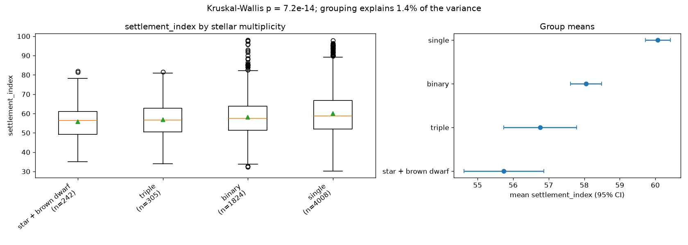

| multiplicity | n | mean | median | sd | ci95 |
|---|---|---|---|---|---|
| star + brown dwarf | 242 | 55.74 | 56.43 | 8.89 | 1.12 |
| triple | 305 | 56.76 | 56.69 | 9.15 | 1.03 |
| binary | 1824 | 58.05 | 57.52 | 9.59 | 0.44 |
| single | 4008 | 60.07 | 58.71 | 11.37 | 0.35 |

### Q4. How do moons and rings relate to settlement potential?
- **Moons:** Spearman rho = -0.09, a negligible association, significant (p = 4.3e-14). Split by rings: rho = -0.10 without rings and -0.04 with rings.
- **Rings:** planets with rings average 56.8 versus 59.4 without (-2.7 points); the difference is significant (p = 6.3e-08) and rings explain 0.6% of the variance.

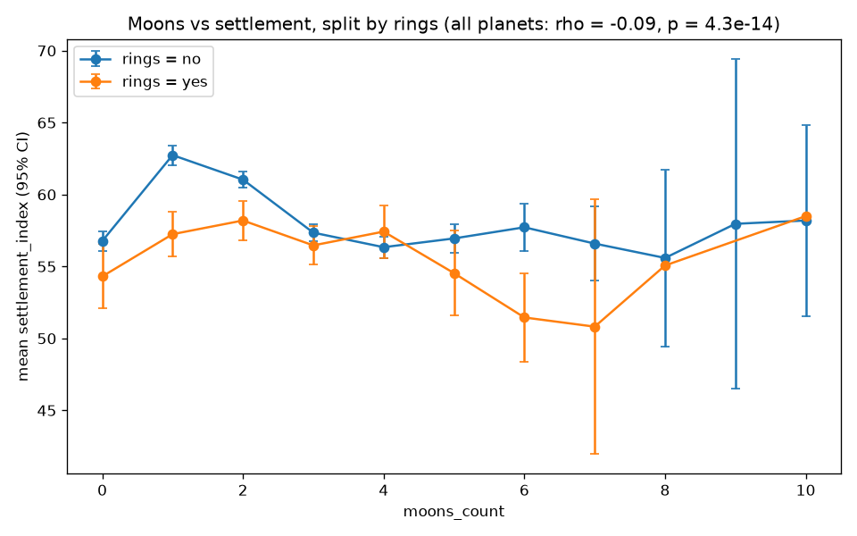
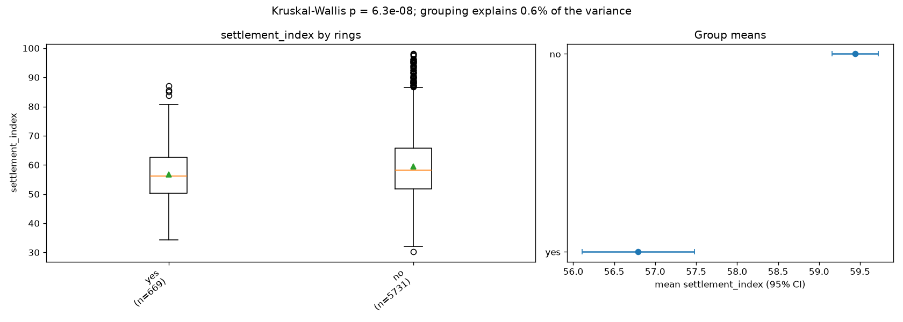

### Q5. How do rogue and tidally locked planets compare with other planets?
The mean settlement_index is highest for **neither** (59.8, n = 5127) and lowest for **tidally locked** (56.6, n = 736). The difference between the planet-label groups is significant (p = 3.2e-15) and the grouping explains 1.4% of the variance of settlement_index. After Bonferroni correction the significantly different pairs are: neither vs tidally locked (+3.2 points, p = 2.7e-10); rogue planet vs neither (-3.1 points, p = 4.8e-08). "Tidally locked" includes the variants (such as "tidally locked ocean world") that cleaning merged into that label.

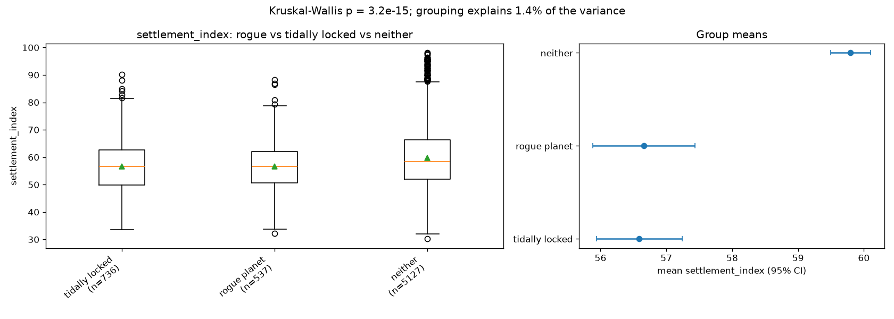

| group | n | mean | median | sd | ci95 |
|---|---|---|---|---|---|
| tidally locked | 736 | 56.59 | 56.68 | 9.03 | 0.65 |
| rogue planet | 537 | 56.66 | 56.56 | 9.13 | 0.77 |
| neither | 5127 | 59.8 | 58.46 | 11.07 | 0.3 |

### Independent investigation: is there a Goldilocks property?
**Question.** Which physical property (outside Q1-Q5) shapes settlement potential the most, and is the effect "more is better" or a Goldilocks optimum, where intermediate values are best?

**Method.** For each remaining numeric property I compared the variance of settlement_index explained by a monotonic trend (Spearman rho squared) with the variance explained by any shape (means of 12 equal-count bins). A large gap would mean a non-monotonic effect. The three strongest properties were then each fitted with a straight line and a quadratic curve and compared with an F-test (on percentile ranks, so heavy tails cannot dominate), and the two most non-monotonic ones were viewed together in a heatmap. Only recorded values were used.

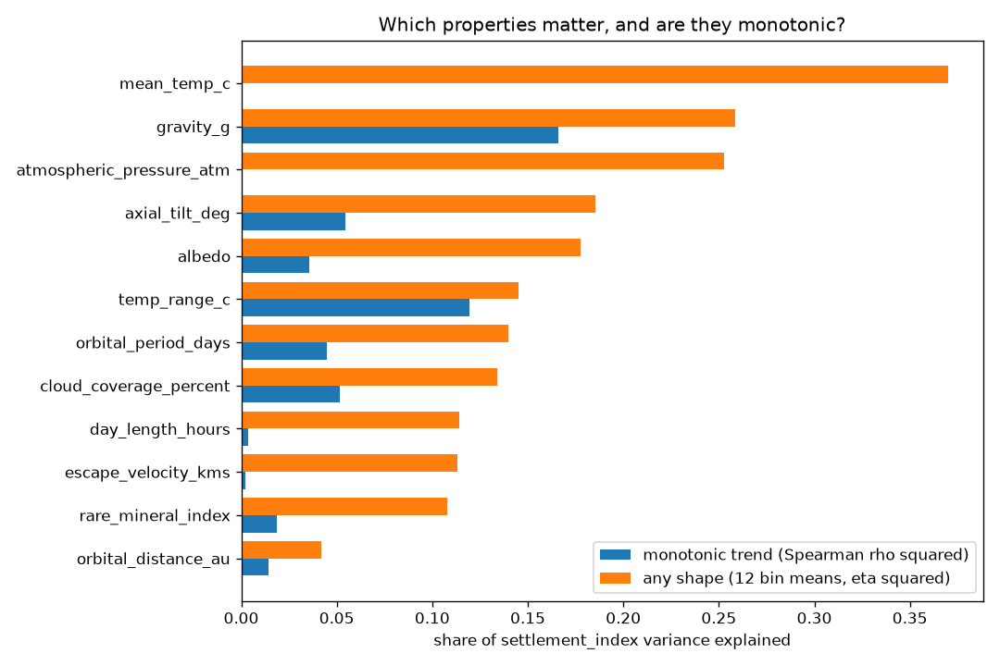

**Result.** The three strongest properties are examined below. "Any-shape" is the variance explained by 12 bin means; a large excess over the monotonic share signals a non-monotonic effect.

- **mean_temp_c**: any-shape eta squared 37.0% against 0.1% for a monotonic trend (Spearman rho = -0.03); quadratic vs straight line p < 1e-300; the data show an interior optimum (Goldilocks), located at about 12.5 (percentile 50%).
- **gravity_g**: any-shape eta squared 25.8% against 16.6% for a monotonic trend (Spearman rho = 0.41); quadratic vs straight line p = 9.3e-46; the data show a curved but essentially monotonic relationship (the quadratic's turning point is at or beyond the edge of the data).
- **atmospheric_pressure_atm**: any-shape eta squared 25.3% against 0.0% for a monotonic trend (Spearman rho = -0.00); quadratic vs straight line p = 1e-285; the data show an interior optimum (Goldilocks), located at about 1.03 (percentile 50%).

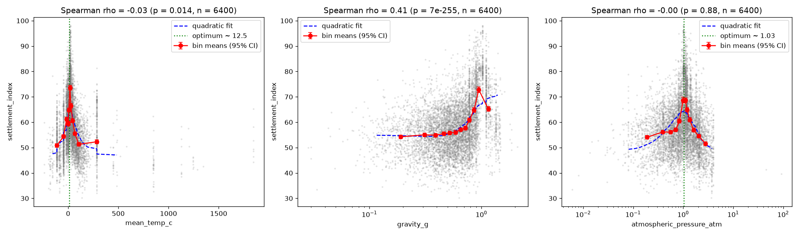

Viewed together, mean_temp_c and atmospheric_pressure_atm give the following picture: the highest-scoring bin pair (mean 79.2) has mean_temp_c between 13.5 and 28 and atmospheric_pressure_atm between 0.838 and 1.02, while the worst bin pair averages 46.0.

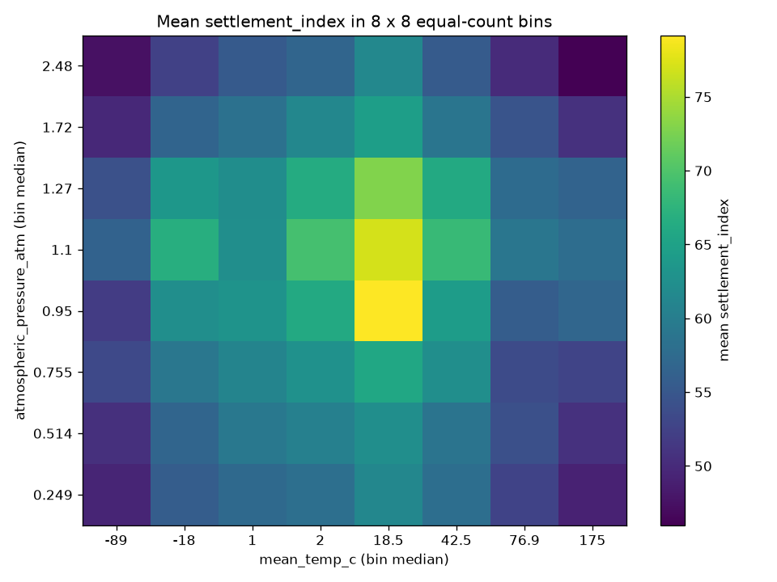

| feature | monotonic_R2 | any_shape_eta2 | n | gap |
|---|---|---|---|---|
| mean_temp_c | 0.0 | 0.37 | 6400 | 0.37 |
| gravity_g | 0.17 | 0.26 | 6400 | 0.09 |
| atmospheric_pressure_atm | 0.0 | 0.25 | 6400 | 0.25 |
| axial_tilt_deg | 0.05 | 0.18 | 6352 | 0.13 |
| albedo | 0.04 | 0.18 | 6400 | 0.14 |
| temp_range_c | 0.12 | 0.14 | 6400 | 0.03 |
| orbital_period_days | 0.04 | 0.14 | 5761 | 0.1 |
| cloud_coverage_percent | 0.05 | 0.13 | 6400 | 0.08 |
| day_length_hours | 0.0 | 0.11 | 6344 | 0.11 |
| escape_velocity_kms | 0.0 | 0.11 | 5758 | 0.11 |
| rare_mineral_index | 0.02 | 0.11 | 6400 | 0.09 |
| orbital_distance_au | 0.02 | 0.04 | 5763 | 0.03 |

**Conclusion.** The Goldilocks hypothesis is supported for mean_temp_c and atmospheric_pressure_atm: settlement potential is best at intermediate values and falls off on both sides, so a 'more is better' rule would misjudge these properties.

### Limitations
Associations, not causes; the properties are correlated with each other (for example gases with planet type), so a trend in one may reflect another. Ten-plus comparisons were run, so a single p-value just under 0.05 should not be over-read. Cleaning choices (merged labels, `other` bucket, imputed values) can move individual group means slightly.

---

## Bonus task: rebuilding EDEN (team llcd)

### Approach
A planet is viable when settlement_index >= 60; 42.3% of the 6400 training planets are viable, so always guessing the majority class would score 57.7% accuracy. The model uses the 49 cleaned planet properties (identifiers and the target are excluded; categorical properties are one-hot encoded inside the pipeline; the atmosphere string is parsed into one numeric column per gas, which changed the untuned regressor's validation R^2 from 0.832 to 0.832). Three candidates were compared on a stratified 20% hold-out (1280 planets) that was never used for fitting or tuning: a logistic-regression baseline, a gradient-boosting classifier, and a gradient-boosting regressor that predicts the settlement_index and then applies the >= 60 threshold. The two boosting models were tuned by random search with 3-fold cross-validation on the training part only. The winner by F1 (the task names no metric) was refitted on all 6400 training planets to predict the 1600 test planets.

### Results on the hold-out planets
| model | accuracy | precision | recall | F1 | ROC_AUC |
|---|---|---|---|---|---|
| Logistic regression | 0.827 | 0.822 | 0.756 | 0.788 | 0.89 |
| Boosting classifier | 0.87 | 0.859 | 0.83 | 0.844 | 0.94 |
| Boosting regressor + threshold | 0.882 | 0.872 | 0.845 | 0.858 | 0.944 |

The best model is **Boosting regressor + threshold**. It beats the logistic-regression baseline by 0.071 F1; this is consistent with the non-monotonic (Goldilocks) effects found in Part Two, where intermediate values of properties such as temperature are best: a linear model cannot represent them, whereas tree-based models can. The boosting regressor explains R^2 = 0.84 of the settlement_index on the hold-out planets. Confusion matrix of the best model (rows actual, columns predicted; not viable / viable): [[671, 67], [84, 458]].

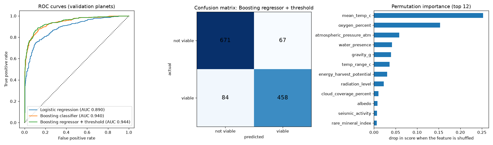

### Discussion
- **Where it errs.** 118 of the 151 misclassified hold-out planets (78%) have a true index within 5 points of the threshold, a band that contains 35% of all planets. Accuracy is 73.4% inside that band and 96.1% outside it, so most mistakes are planets that are genuinely borderline.
- **What it relies on.** The properties whose shuffling hurts the score most are: mean_temp_c (0.253), oxygen_percent (0.153), atmospheric_pressure_atm (0.059), water_presence (0.042), gravity_g (0.040), temp_range_c (0.036).
- **Test predictions.** 41.2% of the 1600 test planets are predicted viable, against 42.3% in the training data.

### Limitations
The validation set has 1280 planets, so the metrics carry a sampling error of roughly +/-1.8 percentage points. The best of three candidates was picked on that same hold-out, so its score is slightly optimistic. Cleaning statistics (medians, label frequencies) were fitted on all training planets before splitting, a negligible leak. Importance is permutation-based and shares credit between correlated properties. The model learns associations in simulated data and says nothing about causes.
