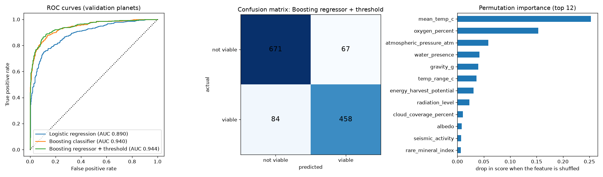

# Bonus task: rebuilding EDEN (team llcd)

## Approach
A planet is viable when settlement_index >= 60; 42.3% of the 6400 training planets are viable, so always guessing the majority class would score 57.7% accuracy. The model uses the 49 cleaned planet properties (identifiers and the target are excluded; categorical properties are one-hot encoded inside the pipeline; the atmosphere string is parsed into one numeric column per gas, which changed the untuned regressor's validation R^2 from 0.832 to 0.832). Three candidates were compared on a stratified 20% hold-out (1280 planets) that was never used for fitting or tuning: a logistic-regression baseline, a gradient-boosting classifier, and a gradient-boosting regressor that predicts the settlement_index and then applies the >= 60 threshold. The two boosting models were tuned by random search with 3-fold cross-validation on the training part only. The winner by F1 (the task names no metric) was refitted on all 6400 training planets to predict the 1600 test planets.

## Results on the hold-out planets
| model | accuracy | precision | recall | F1 | ROC_AUC |
|---|---|---|---|---|---|
| Logistic regression | 0.827 | 0.822 | 0.756 | 0.788 | 0.89 |
| Boosting classifier | 0.87 | 0.859 | 0.83 | 0.844 | 0.94 |
| Boosting regressor + threshold | 0.882 | 0.872 | 0.845 | 0.858 | 0.944 |

The best model is **Boosting regressor + threshold**. It beats the logistic-regression baseline by 0.071 F1; this is consistent with the non-monotonic (Goldilocks) effects found in Part Two, where intermediate values of properties such as temperature are best: a linear model cannot represent them, whereas tree-based models can. The boosting regressor explains R^2 = 0.84 of the settlement_index on the hold-out planets. Confusion matrix of the best model (rows actual, columns predicted; not viable / viable): [[671, 67], [84, 458]].

## Discussion
- **Where it errs.** 118 of the 151 misclassified hold-out planets (78%) have a true index within 5 points of the threshold, a band that contains 35% of all planets. Accuracy is 73.4% inside that band and 96.1% outside it, so most mistakes are planets that are genuinely borderline.
- **What it relies on.** The properties whose shuffling hurts the score most are: mean_temp_c (0.253), oxygen_percent (0.153), atmospheric_pressure_atm (0.059), water_presence (0.042), gravity_g (0.040), temp_range_c (0.036).
- **Test predictions.** 41.2% of the 1600 test planets are predicted viable, against 42.3% in the training data.

## Limitations
The validation set has 1280 planets, so the metrics carry a sampling error of roughly +/-1.8 percentage points. The best of three candidates was picked on that same hold-out, so its score is slightly optimistic. Cleaning statistics (medians, label frequencies) were fitted on all training planets before splitting, a negligible leak. Importance is permutation-based and shares credit between correlated properties. The model learns associations in simulated data and says nothing about causes.
