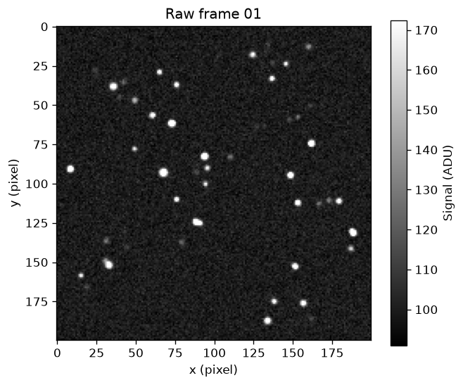
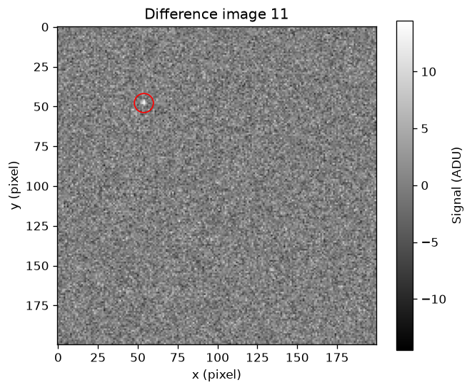
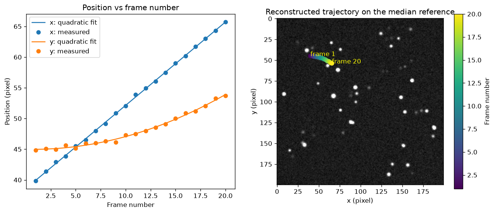

# Task 1: Signal in the Static (team llcd)

All figures and numbers below are produced by `llcd_notebook_FITS.ipynb`.

## 1. Raw frames
There are 20 FITS frames of 200 x 200 pixels (field "EDEN Deep Field 07", 60.0 s exposures, signal in ADU), ordered by the `FRAME` header keyword. `DATE-OBS` gives 90-90 s between consecutive frames. The headers contain no world-coordinate information, so there is no pixel scale: positions and speeds are in pixels. Every frame is plotted with labelled axes and a colorbar in `llcd_FITS_outputs/raw_frames/`, all with one shared contrast stretch (1st-99.5th percentile) so they can be compared directly.

## 2. Median reference and difference images
The reference image is the per-pixel median of all 20 frames (`llcd_FITS_outputs/median_reference.png`). Stars and background sit on the same pixels in every frame, so they pass through the median unchanged, while the moving source occupies any one pixel in only a few frames, so the median rejects it. Subtracting the reference from each frame (and removing the small per-frame background offset) cancels everything static and leaves only what changed in that frame: the moving source as a faint positive blob, plus noise and small residuals around the brightest stars. The difference images are in `llcd_FITS_outputs/difference_images/`, with the tracked source circled in red.

## 3. Detecting the moving source
The noise of each difference image is its sigma-clipped standard deviation (mean 2.90 ADU). Each difference image is smoothed with a 1-pixel Gaussian, which suits a point source and lowers the noise to 0.83 ADU, and every group of at least 2 connected pixels above 5 sigma is a candidate. This gives 23 candidates. They are separated as follows:
- **0 static residuals** (imperfectly subtracted stars): a detection that recurs within 2 px of the same spot in more than half of the frames cannot be a moving object.
- **3 other candidates** (isolated noise peaks): they do not line up with each other or with the track.
- **20 detections that form one track**: the constant-velocity line matched (within 2 px) by detections in the most frames, whose detections spread over at least 6 px (a stationary residual cannot do that). The source is detected in 20 of 20 frames, one detection per frame.

## 4. Trajectory
Measured centroids and the fitted path (`llcd_trajectory.png`):

| frame | x_measured | y_measured | x_model | y_model |
|---|---|---|---|---|
| 1 | 39.85 | 44.81 | 39.95 | 44.97 |
| 2 | 41.36 | 45.08 | 41.3 | 45.01 |
| 3 | 42.92 | 44.99 | 42.65 | 45.1 |
| 4 | 43.85 | 45.65 | 44.01 | 45.24 |
| 5 | 45.53 | 45.13 | 45.36 | 45.42 |
| 6 | 46.52 | 45.94 | 46.72 | 45.65 |
| 7 | 48.0 | 45.98 | 48.07 | 45.93 |
| 8 | 49.17 | 46.31 | 49.43 | 46.26 |
| 9 | 50.9 | 46.14 | 50.78 | 46.63 |
| 10 | 52.02 | 47.29 | 52.14 | 47.05 |
| 11 | 53.9 | 47.5 | 53.49 | 47.52 |
| 12 | 54.93 | 47.96 | 54.85 | 48.04 |
| 13 | 56.07 | 48.51 | 56.21 | 48.6 |
| 14 | 57.48 | 49.08 | 57.56 | 49.22 |
| 15 | 59.02 | 49.99 | 58.92 | 49.88 |
| 16 | 60.17 | 50.87 | 60.28 | 50.58 |
| 17 | 61.7 | 51.21 | 61.63 | 51.34 |
| 18 | 63.0 | 52.03 | 62.99 | 52.14 |
| 19 | 64.3 | 53.29 | 64.35 | 53.0 |
| 20 | 65.72 | 53.71 | 65.71 | 53.9 |

The source follows a smooth, slightly curved path: a quadratic fits the measured centroids significantly better than a straight line (F-test p = 6.5e-16; RMS residual 0.27 px vs 0.76 px), so the apparent velocity changes slowly from 1.35 to 1.64 px/frame. Over the 20 frames it travels 28 px (overall direction 19 degrees from the +x axis, y pointing down), i.e. about 0.97 px per minute at the 90 s frame spacing.

**What kind of object?** Stars and nebulosity do not move and noise does not move coherently, so a source that shifts smoothly in one direction over 20 frames is a real object whose position relative to the background stars changes. That is the signature of a foreground body: in a real survey a solar-system minor body (asteroid or comet), another nearby object, or an artificial one such as a spacecraft. A slowly changing apparent velocity is what a body on a gravity-curved orbit shows, or any body seen from a moving observer. Distance, size and physical speed cannot be obtained because the headers have no pixel scale.

## 5. Noise, signal strength, reliability and limitations
- **Noise:** 2.90 ADU per pixel in the difference images (frame-to-frame range 2.87-2.93 ADU); 0.83 ADU after smoothing.
- **Signal:** the source peaks at 14.9 ADU (median over detected frames), which is 5.1 sigma in the raw difference images (weakest frame 3.4 sigma) and 9.9 sigma in the smoothed ones.
- **Reliability:** with Gaussian noise only 0.23 pixels over all frames would exceed 5 sigma by chance. The source is found in 20 of 20 frames and the centroids follow one smooth path to 0.27 px RMS, so a chance alignment of noise peaks is extremely unlikely.
- **Limitations:** (1) In single raw frames the source is only about 5 sigma, so the detection relies on smoothing and on consistency across frames, not on any one frame. (2) The noise is not perfectly Gaussian: near bright stars the subtraction leaves larger residuals, so the global sigma understates the local noise there. (3) The path model is a low-order polynomial; the measured centroids scatter by 0.27 px RMS around it. (4) A source that stays within 2 px for more than half of the frames would be absorbed into the median and removed as static. (5) Only the single best track is searched for; a second, fainter mover would need another pass. (6) Without a pixel scale, no physical size, distance or speed can be derived.
