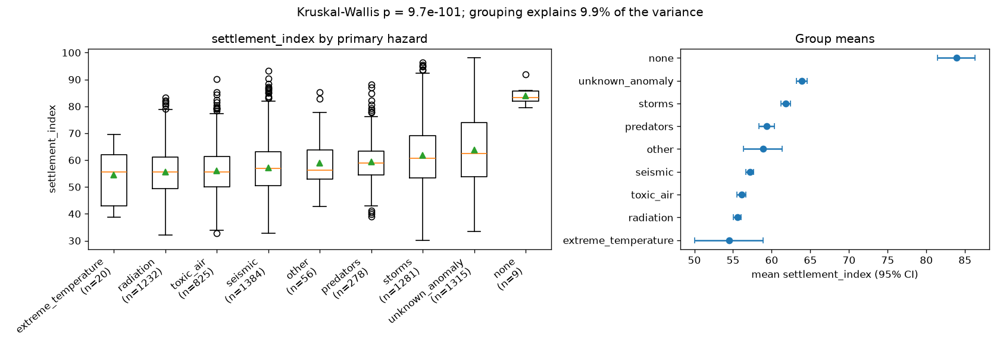
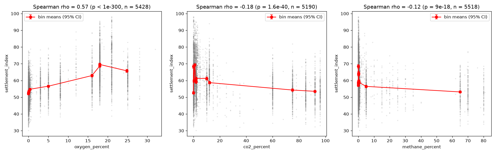
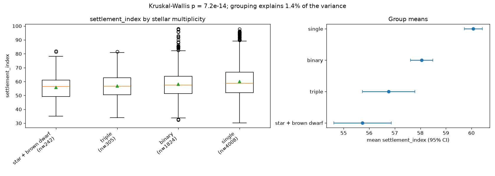
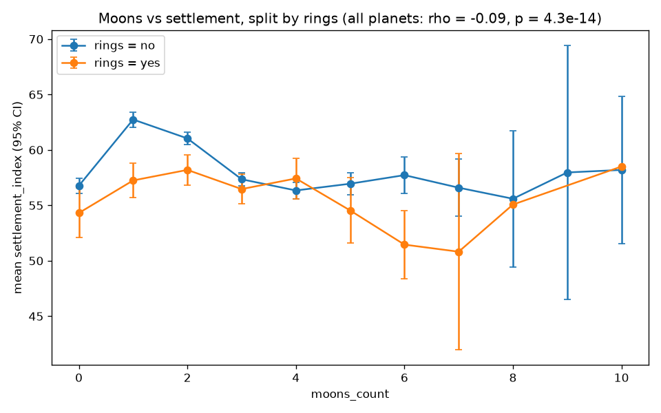
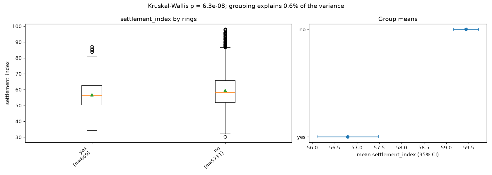
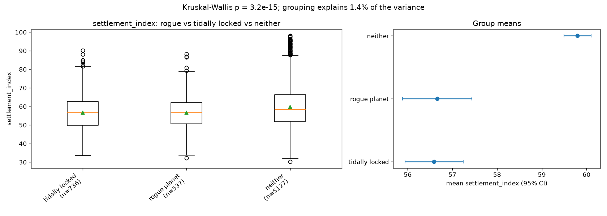
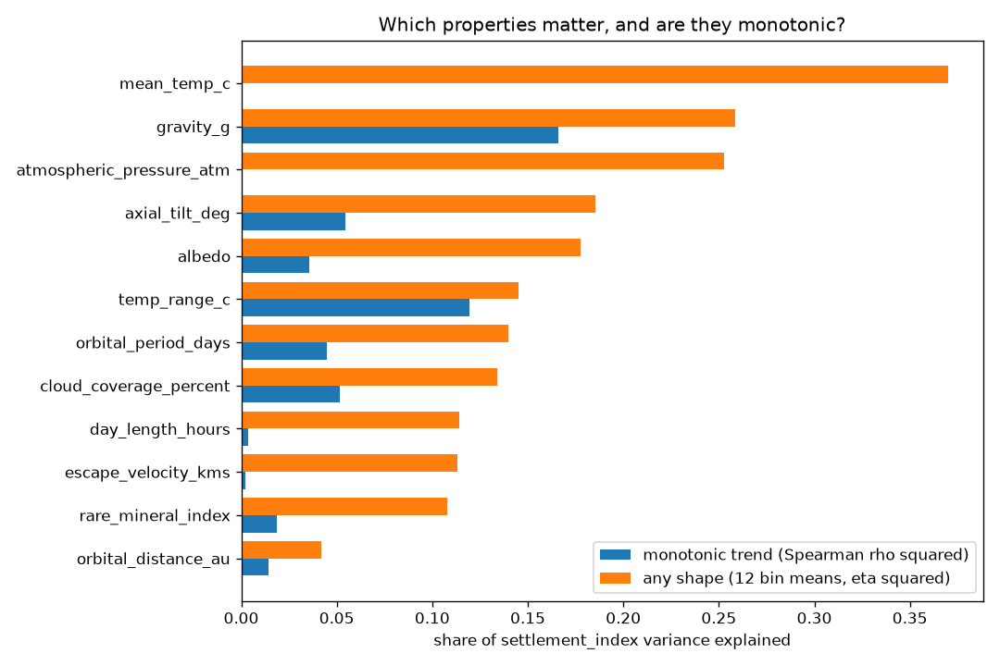
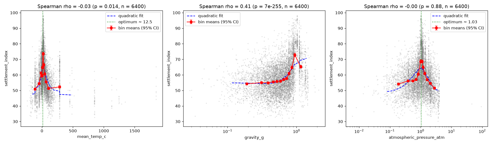
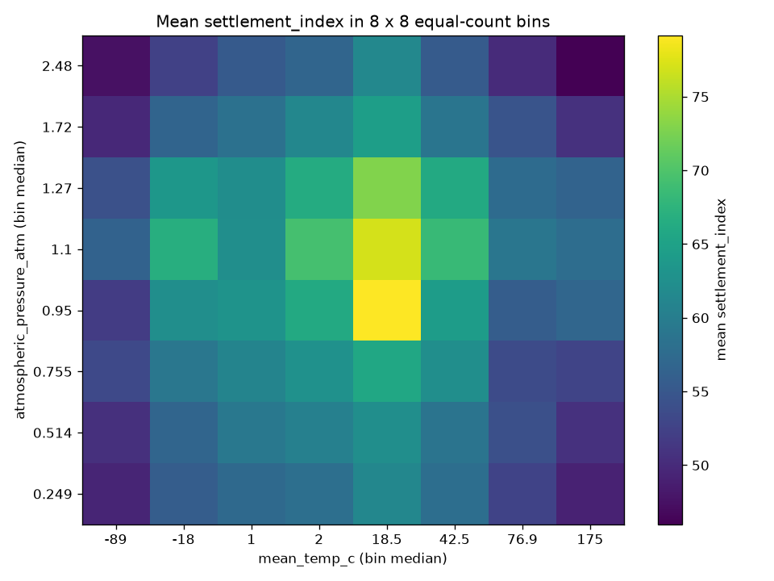

# Task 2: Data analysis (team llcd)

All numbers and figures come from `llcd_notebook_analysis.ipynb`, which analyses `llcd_cleaned_dataset.csv` (6400 planets; settlement_index mean 59.2, sd 10.8). Group differences use Kruskal-Wallis and Bonferroni-corrected Mann-Whitney tests, trends use Spearman's rho; all are rank-based because the data are skewed. The data are observational, so every result is an association, not proof of cause, and planets that differ in one property also differ in others.

## Q1. How does the recorded primary hazard relate to settlement potential?
The mean settlement_index is highest for **none** (83.9, n = 9) and lowest for **extreme_temperature** (54.5, n = 20). The difference between the hazard groups is significant (p = 9.7e-101) and the grouping explains 9.9% of the variance of settlement_index.

| primary_hazard | n | mean | median | sd | ci95 |
|---|---|---|---|---|---|
| extreme_temperature | 20 | 54.46 | 55.57 | 10.13 | 4.44 |
| radiation | 1232 | 55.54 | 55.57 | 8.48 | 0.47 |
| toxic_air | 825 | 56.1 | 55.69 | 8.45 | 0.58 |
| seismic | 1384 | 57.16 | 56.9 | 9.53 | 0.5 |
| other | 56 | 58.85 | 56.24 | 9.58 | 2.51 |
| predators | 278 | 59.35 | 58.84 | 8.45 | 0.99 |
| storms | 1281 | 61.84 | 60.7 | 11.11 | 0.61 |
| unknown_anomaly | 1315 | 63.87 | 62.5 | 12.7 | 0.69 |
| none | 9 | 83.9 | 83.35 | 3.71 | 2.42 |

## Q2. How do atmospheric gas levels relate to settlement potential?
Only planets whose value was recorded (not filled in during cleaning) are used for each gas.

- **oxygen_percent**: Spearman rho = 0.57, a strong positive association, significant (p < 1e-300); the decile means are highest around 18 % (69.6) and lowest around 0 % (52.2).
- **co2_percent**: Spearman rho = -0.18, a weak negative association, significant (p = 1.6e-40); the decile means are highest around 1 % (69.3) and lowest around 0 % (52.6).
- **methane_percent**: Spearman rho = -0.12, a weak negative association, significant (p = 9e-18); the decile means are highest around 0.0002 % (68.5) and lowest around 65 % (53.2).

## Q3. How does stellar multiplicity relate to settlement potential?
The mean settlement_index is highest for **single** (60.1, n = 4008) and lowest for **star + brown dwarf** (55.7, n = 242). The difference between the multiplicity groups is significant (p = 7.2e-14) and the grouping explains 1.4% of the variance of settlement_index. After Bonferroni correction the significantly different pairs are: single vs binary (+2.0 points, p = 3.2e-07); single vs star + brown dwarf (+4.3 points, p = 4.8e-07); single vs triple (+3.3 points, p = 5.2e-05); binary vs star + brown dwarf (+2.3 points, p = 0.0089). Star types that name no multiplicity were treated as single stars, and the few labels merged into `other` during cleaning could not be classified, so they are left out of this comparison.

| multiplicity | n | mean | median | sd | ci95 |
|---|---|---|---|---|---|
| star + brown dwarf | 242 | 55.74 | 56.43 | 8.89 | 1.12 |
| triple | 305 | 56.76 | 56.69 | 9.15 | 1.03 |
| binary | 1824 | 58.05 | 57.52 | 9.59 | 0.44 |
| single | 4008 | 60.07 | 58.71 | 11.37 | 0.35 |

## Q4. How do moons and rings relate to settlement potential?
- **Moons:** Spearman rho = -0.09, a negligible association, significant (p = 4.3e-14). Split by rings: rho = -0.10 without rings and -0.04 with rings.
- **Rings:** planets with rings average 56.8 versus 59.4 without (-2.7 points); the difference is significant (p = 6.3e-08) and rings explain 0.6% of the variance.

## Q5. How do rogue and tidally locked planets compare with other planets?
The mean settlement_index is highest for **neither** (59.8, n = 5127) and lowest for **tidally locked** (56.6, n = 736). The difference between the planet-label groups is significant (p = 3.2e-15) and the grouping explains 1.4% of the variance of settlement_index. After Bonferroni correction the significantly different pairs are: neither vs tidally locked (+3.2 points, p = 2.7e-10); rogue planet vs neither (-3.1 points, p = 4.8e-08). "Tidally locked" includes the variants (such as "tidally locked ocean world") that cleaning merged into that label.

| group | n | mean | median | sd | ci95 |
|---|---|---|---|---|---|
| tidally locked | 736 | 56.59 | 56.68 | 9.03 | 0.65 |
| rogue planet | 537 | 56.66 | 56.56 | 9.13 | 0.77 |
| neither | 5127 | 59.8 | 58.46 | 11.07 | 0.3 |

## Independent investigation: is there a Goldilocks property?
**Question.** Which physical property (outside Q1-Q5) shapes settlement potential the most, and is the effect "more is better" or a Goldilocks optimum, where intermediate values are best?

**Method.** For each remaining numeric property I compared the variance of settlement_index explained by a monotonic trend (Spearman rho squared) with the variance explained by any shape (means of 12 equal-count bins). A large gap would mean a non-monotonic effect. The three strongest properties were then each fitted with a straight line and a quadratic curve and compared with an F-test (on percentile ranks, so heavy tails cannot dominate), and the two most non-monotonic ones were viewed together in a heatmap. Only recorded values were used.

**Result.** The three strongest properties are examined below. "Any-shape" is the variance explained by 12 bin means; a large excess over the monotonic share signals a non-monotonic effect.

- **mean_temp_c**: any-shape eta squared 37.0% against 0.1% for a monotonic trend (Spearman rho = -0.03); quadratic vs straight line p < 1e-300; the data show an interior optimum (Goldilocks), located at about 12.5 (percentile 50%).
- **gravity_g**: any-shape eta squared 25.8% against 16.6% for a monotonic trend (Spearman rho = 0.41); quadratic vs straight line p = 9.3e-46; the data show a curved but essentially monotonic relationship (the quadratic's turning point is at or beyond the edge of the data).
- **atmospheric_pressure_atm**: any-shape eta squared 25.3% against 0.0% for a monotonic trend (Spearman rho = -0.00); quadratic vs straight line p = 1e-285; the data show an interior optimum (Goldilocks), located at about 1.03 (percentile 50%).

Viewed together, mean_temp_c and atmospheric_pressure_atm give the following picture: the highest-scoring bin pair (mean 79.2) has mean_temp_c between 13.5 and 28 and atmospheric_pressure_atm between 0.838 and 1.02, while the worst bin pair averages 46.0.

| feature | monotonic_R2 | any_shape_eta2 | n | gap |
|---|---|---|---|---|
| mean_temp_c | 0.0 | 0.37 | 6400 | 0.37 |
| gravity_g | 0.17 | 0.26 | 6400 | 0.09 |
| atmospheric_pressure_atm | 0.0 | 0.25 | 6400 | 0.25 |
| axial_tilt_deg | 0.05 | 0.18 | 6352 | 0.13 |
| albedo | 0.04 | 0.18 | 6400 | 0.14 |
| temp_range_c | 0.12 | 0.14 | 6400 | 0.03 |
| orbital_period_days | 0.04 | 0.14 | 5761 | 0.1 |
| cloud_coverage_percent | 0.05 | 0.13 | 6400 | 0.08 |
| day_length_hours | 0.0 | 0.11 | 6344 | 0.11 |
| escape_velocity_kms | 0.0 | 0.11 | 5758 | 0.11 |
| rare_mineral_index | 0.02 | 0.11 | 6400 | 0.09 |
| orbital_distance_au | 0.02 | 0.04 | 5763 | 0.03 |

**Conclusion.** The Goldilocks hypothesis is supported for mean_temp_c and atmospheric_pressure_atm: settlement potential is best at intermediate values and falls off on both sides, so a 'more is better' rule would misjudge these properties.

## Limitations
Associations, not causes; the properties are correlated with each other (for example gases with planet type), so a trend in one may reflect another. Ten-plus comparisons were run, so a single p-value just under 0.05 should not be over-read. Cleaning choices (merged labels, `other` bucket, imputed values) can move individual group means slightly.
